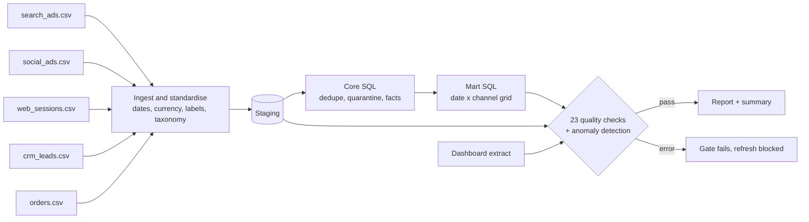
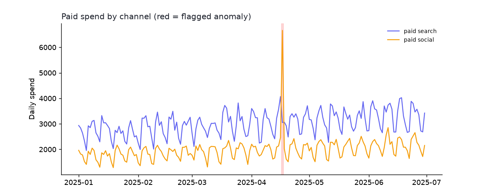
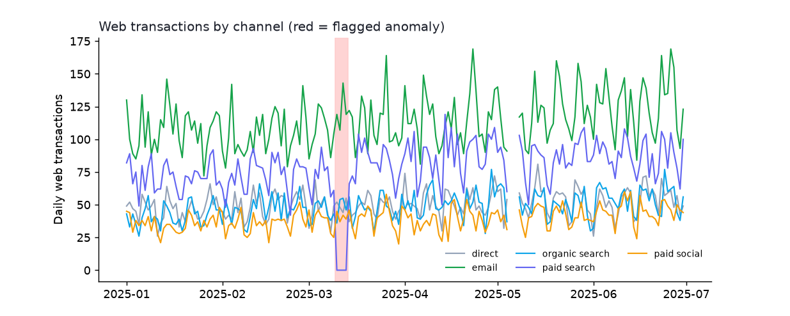

# Marketing Data Pipeline with Quality Gates

**Can you trust the numbers in the dashboard?** This project is a small, fully tested pipeline that takes five messy marketing exports (two ad platforms, web analytics, CRM leads, orders), standardises them, loads a SQL warehouse, runs 23 data-quality checks, detects anomalies, reconciles sources against each other, and publishes a report that can **block a bad refresh**.

> **Read this first: the data is synthetic.**
> `mktg_pipeline.generate` creates 181 days of internally consistent marketing data in the awkward formats real exports use (`$1,234.56`, `MM/DD/YYYY`, `google / cpc`). It can then inject **11 documented defects** and write an answer key, so detection can be *measured* rather than assumed. Nothing here is employer or customer data.



## What it does, measured

| Run | Quality gate | Checks passed | Anomaly incidents |
|---|---|---:|---:|
| Clean data | **PASS** | 23 of 23 | 0 |
| Data with 11 injected defects | **FAIL** (by design) | 9 of 23 | 2 |

**Detection scorecard: 11 of 11 injected defects caught, with no unexpected failures.** Sample reports are committed: [`reports/clean/report.html`](reports/clean/report.html) and [`reports/defects/report.html`](reports/defects/report.html).

| ID | Injected defect | Caught by |
|---|---|---|
| D01 | 60 exact duplicate CRM leads | C04 unique lead id |
| D02 | 40 near-duplicate leads (same email, different case and spacing) | C05 one lead per email |
| D03 | 80 leads with a blank or null email | C07 leads have an email |
| D04 | 15 ad rows with no campaign name | C08 campaign not null |
| D05 | 25 leads with an unknown status code | C09 status is known |
| D06 | One day of paid social spend multiplied by 6 (decimal error) | C20 spend anomaly (z = 16.6, on 2025-04-17) |
| D07 | Tracking break: 4 days of zero web transactions for paid search | C15 web vs orders, C21 conversion anomaly (z = -30.2, 2025-03-10 to 03-13) |
| D08 | 3 whole days missing from web analytics | C01 every day present |
| D09 | 5 orders with negative revenue, 3 dated in the future | C12, C13 |
| D10 | A traffic source the taxonomy has never seen (`tiktok / paid_social`) | C10 sources are known |
| D11 | A dashboard query that joins to leads and **multiplies revenue** (join fan-out) | C18 dashboard matches the warehouse |

Specificity matters as much as sensitivity, so the test suite injects **each defect alone** and asserts that exactly the documented checks fire and nothing else. It also checks for false alarms on 4 independent clean datasets and 20 random weekly-seasonal series.




## How the pieces work

* **Ingest** (`ingest.py`): per-source schema mapping, `$` and comma stripping, date parsing with explicit formats, case and whitespace normalisation, channel and status taxonomies. It *never drops or repairs rows*; anything it cannot map is flagged and kept so the checks can see it.
* **Core SQL** (`sql/10_core.sql`): dimensions, `ROW_NUMBER()` deduplication (one lead per email, earliest wins), unknown traffic sources and invalid orders **quarantined with a reason** instead of silently merged.
* **Mart SQL** (`sql/20_mart.sql`): a `date x channel` grid with a left join per source, so a missing day shows up as `NULL`, never as a missing row.
* **Checks** (`checks.py`): 23 declarative checks across completeness, freshness, uniqueness, not-null, accepted values, ranges, cross-source reconciliation, validity, lineage and anomalies. Errors fail the gate; warnings are reported.
* **Anomaly detection** (`anomalies.py`): each day is compared with the median of the same weekday over the previous four weeks on a log scale, scored with a robust z (median absolute deviation), and consecutive days are grouped into incidents. No weekend false alarms, and a spike and a drop to zero are both caught.
* **Report** (`report.py`): self-contained HTML, a Markdown summary for CI job summaries, a last-seven-days versus previous-seven-days KPI table, and the detection scorecard.

## Run it

```bash
python -m venv .venv && source .venv/bin/activate
pip install -r requirements.txt

PYTHONPATH=src python -m mktg_pipeline demo                       # clean + broken data, both reports (about 7 seconds)
PYTHONPATH=src python -m mktg_pipeline generate --out data/raw --defects
PYTHONPATH=src python -m mktg_pipeline run --raw data/raw --gate --legacy-dashboard   # exit status 1 when a check errors
pytest                                                             # 58 tests
```

To use it on real exports, drop CSVs with the same five schemas into a folder (see [`docs/data_dictionary.md`](docs/data_dictionary.md)) and run `run --raw <folder> --gate`. The `.github/workflows/weekly-report.yml` job shows how to schedule it and publish the summary.

## Documentation

* [`docs/data_dictionary.md`](docs/data_dictionary.md): every source, staging, core and mart table
* [`docs/kpi_definitions.md`](docs/kpi_definitions.md): KPI formulas and data-quality metrics
* [`docs/qa_runbook.md`](docs/qa_runbook.md): what to do when each check fails
* [`docs/campaign_qa_checklist.md`](docs/campaign_qa_checklist.md): pre-launch, launch-day and post-launch checks for a campaign

## Limitations

* The defects are ones I chose, so 11 of 11 shows the checks do what they were designed to do, not that every real-world failure will be caught. Real exports will find new ways to break.
* Anomaly detection assumes a weekly pattern and a few weeks of history; it needs tuning (and probably holiday handling) for real seasonality.
* Reconciliation tolerances (5% for transactions, 2% for revenue, 0.5% for the dashboard) are sensible defaults, not universal truths.
* SQLite stands in for a warehouse. The SQL uses standard window functions and recursive CTEs, but would need dialect changes elsewhere.

## Skills this project demonstrates

SQL ETL (staging, core, mart, window functions, recursive CTEs), Python and Pandas, data cleaning, validation and reconciliation across sources, anomaly detection, KPI definition, reporting automation, process documentation, and testing data pipelines against known defects.
